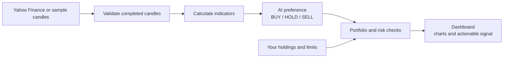

# FastTrade AI

**See the market. Check the signal. Stay in control.**

FastTrade uses [Jev, TypeSafe’s first public System One model](https://typesafe.ai/), for fast, low-cost trading analysis with measurable decision accuracy. It combines candlestick charts and technical indicators with BUY / HOLD / SELL preferences, checks your portfolio limits, and **never places orders**.

## Get started

Install [uv](https://docs.astral.sh/uv/) and Python 3.10+, then add your TypeSafe key to `.env`:

```powershell
Copy-Item .env.example .env
# Set TYPESAFE_API_KEY in .env
uv run ft
```

Open [localhost:8765](http://127.0.0.1:8765/), choose a symbol and timeframe, and select **Run analysis**. Press Ctrl+C to stop.

## How it works



Without complete portfolio and risk inputs, analysis is **signal only** and no risk-checked action is available. Stale data and synthetic samples block portfolio actions. Each analysis calls the model and may incur a charge.

## Benchmark at a glance

**$10,000 starting cash · 25 stocks · 26 weekly reviews · January–June 2026**

| Measure | FastTrade |
| --- | ---: |
| Ending balance | **$10,660.23** |
| Return | **+6.60%** |
| Directional accuracy | **49.0%** · 199 / 406 |
| Model latency | **858 ms** median · **1,004 ms** p95 |
| Total model cost | **$0.0224** estimated |

Over the same period, **SPY returned +9.35%**, turning $10,000 into **$10,935.10**.

[Benchmark method & data](docs/benchmark-2026-h1.md) · [Usage guide](docs/usage.md) · [API reference](http://127.0.0.1:8765/docs) (when running)

Run a weekly historical benchmark with a different model, date range or ticker list:

```powershell
uv run ft benchmark --start 2026-09-28 --end 2026-10-23 --symbols AAPL,MSFT,NVDA --model jev-latest
```

The command makes paid model requests and outputs a JSON report with decisions and a SPY comparison. Historical Yahoo hourly data has limited availability; results exclude costs and do not establish future performance. [Benchmark details](docs/usage.md#historical-benchmark).
