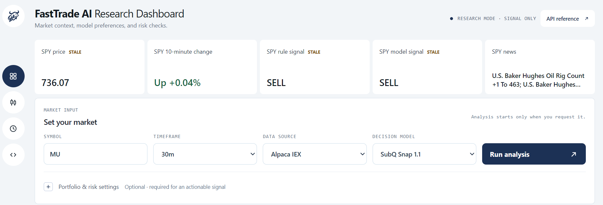
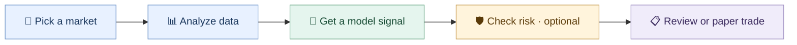

# FastTrade AI

FastTrade is a market research dashboard for exploring BUY, HOLD and SELL signals. Choose up to five tickers, inspect their charts and indicators, compare model preferences with a simple rule, and try paper trades in your browser.

This is a research project. Signals aren't guarantees, paper trades are simulated, and FastTrade doesn't place orders.

## How it works



You can add portfolio values and limits to check a proposed trade. If any inputs are missing, you get the model preference only. The dashboard can load example inputs, but those aren't your account details or recommended limits. The rule comparison is unvalidated, and model confidence isn't the chance of profit.

Paper trades use the last completed close. The dashboard suggests a quantity using 10% of paper cash for a buy or 10% of shares held for a sell; you can change it before confirming. The suggested quantity isn't risk-checked. Your paper portfolio and optional saved history stay in the browser on this device. Stale data, synthetic samples and reopened history can't be paper traded.

## Get started

Install Python 3.10+ and `uv`. Copy the environment file, then add your TypeSafe key. Add Alpaca credentials if you want Alpaca data.

```powershell
Copy-Item .env.example .env
# Set TYPESAFE_API_KEY; for Alpaca also set ALPACA_API_KEY and ALPACA_SECRET_KEY
uv run ft
```

Open `http://127.0.0.1:8765/`. The dashboard defaults to Alpaca IEX and also supports Yahoo Finance. Jev is the default decision model; other configured providers can be selected in the dashboard. Model requests, including the automatic SPY summary, may incur charges. Keep API keys in your environment or `.env`.

You can also run an analysis from the command line:

```powershell
uv run ft analyze NVDA --timeframe 5m
uv run ft analyze-batch AAPL MSFT NVDA --concurrency 3
```

Add `--source yahoo` to use Yahoo Finance. For containers, run `docker compose up --build -d`. The dashboard exposes an API reference at `/docs`.

## Backtest snapshot

| Measure | FastTrade | SPY buy-and-hold |
| --- | ---: | ---: |
| Return, Jan–Jun 2026 | +6.60% | +9.35% |
| Return, Oct 2026 (Alpaca IEX) | +2.04% | −0.17% |
| Directional accuracy, Jan–Jun | 49.01% (199 of 406) | Not measured |
| Mean model request time, Jan–Jun | 862 ms | Not applicable |
| Estimated model cost, Jan–Jun | $0.0224 for 650 decisions | Not applicable |

These retrospective tests use hindsight-selected stocks and may contain model lookahead, so they don't establish a live edge. Accuracy excludes HOLD. The six-month test excludes trading costs; the October test includes simulated fees and slippage. Model cost uses a historical rate.

## Tests

Run `uv run pytest` for the Python suite and `node --test tests/chart.test.cjs` for chart calculations. The browser UI suite lives in `tests/ui.test.cjs` and requires Playwright and Chromium. Historical research replay tests also need the local, untracked `docs` folder.

Apache-2.0 license.
