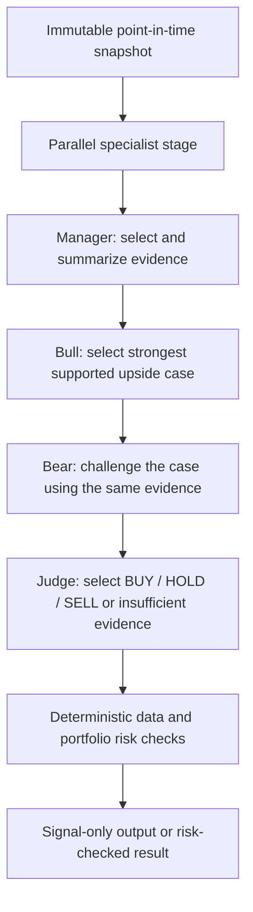

# Multi-Agent Trading Research Implementation Plan

> **For implementers:** Use the executing-plans workflow and complete the tasks in order. This is a proposal for future work; it does not authorize live trading or require implementation now. The scope and decisions in this document serve as the specification.

**Goal:** Add a research-only workflow that combines parallel specialist decision agents, a sequential manager, a bull/bear debate, and a final judge, with transparent evidence and optional portfolio-aware risk checks.

**Architecture:** Build one immutable point-in-time snapshot, run independent specialist judgments concurrently, then run manager → bull → bear → judge in sequence. Deterministic code validates the outputs, assembles traceable evidence, applies the existing risk engine, and displays the result; no agent can place an order.

**Tech stack:** Existing Python 3.10+, FastAPI, HTTPX, pandas, pytest, TypeSafe SystemOne/Jev, and the current static dashboard. Do not add an orchestration framework or another paid provider for the first version.

**Decision-model note:** SystemOne returns typed decisions, not generated reasoning. A bull/bear "argument" in this plan is a selection and evaluation of existing, traceable evidence, not a free-form transcript or hidden model rationale. Independent questions that share the same state may be batched in one request, while independent calls using different states can run concurrently. The dependent stages must wait for their inputs. See [TypeSafe primitives](https://docs.typesafe.ai/primitives), [fan-out](https://docs.typesafe.ai/patterns/fan-out), and [confidence](https://docs.typesafe.ai/confidence).

## Product and safety constraints

- Keep the current single-agent analysis available. Multi-agent analysis is an explicit opt-in, never triggered merely by opening the dashboard, and every request can incur model charges.
- Continue to use `ft` as the CLI. The app remains local and signal-only; it does not connect to brokers or place orders.
- Without complete portfolio and risk settings, show the judge's **model preference** and **signal only**; the risk-checked action is unavailable. A portfolio-aware result must pass the existing deterministic `fasttrade.risk.evaluate` limits.
- With unavailable, stale or synthetic required market data, no risk-checked actionable result is available. Show the issue; never turn an agent failure into a BUY or SELL. Missing optional news or fundamentals must be explicitly marked unavailable, never invented.
- Fix a single `as_of` timestamp before gathering data. Every source used in a historical snapshot must have a known availability time on or before `as_of`; preserve source IDs and timestamps. Exclude unverifiable news and current-only company information from historical runs.
- A model's training history, historical source revisions, chosen stock universe and corporate actions can still leak future knowledge. A historical result must never be labeled "leak-free" or treated as proof of a live edge.
- Keep financial arithmetic, portfolio limits, freshness checks, costs, trade simulation, and timestamp filtering in deterministic Python. A typed answer or its confidence is not proof of correctness or of profitable trading.
- Do not make automatic changes to the existing single-agent prompt, historical reports, committed snapshots, or the current backtesting rules. Reuse the existing backtest only where its input and execution assumptions match; otherwise fail with an explanation.

## Proposed workflow



The manager starts after all specialist calls finish or time out. Bull starts after the manager; bear starts after bull and receives both the shared evidence and bull's selected claims; judge starts after both. All loops are bounded to this single pass. The full pipeline's elapsed time, per-stage duration, actual model versions and reported token usage must be recorded; costs are estimated only if a rate and usage are known, otherwise shown as unavailable.

### Parallel specialists

Each role receives only the evidence it needs from the same snapshot. Specialists may be logical groups of typed questions in one request where the state is shared; separate calls must use bounded concurrency. Absence is a first-class status, not a neutral score.

| Specialist | Evidence | Example judgment | Output |
| --- | --- | --- | --- |
| Market | Symbol and, when available, timestamped benchmark/context prices | Does the observed market context support or oppose a long position? | Choice: supportive / mixed / adverse / insufficient. |
| Technical | Existing completed-candle indicators from `fasttrade.indicators.features` | Are the supplied indicators aligned for a long entry? | Choice with insufficient option; include indicator IDs. |
| News | Timestamped, source-attributed headlines | Which available headline is most relevant to the symbol? | Choice from supplied source IDs plus none; never invent a headline. |
| Sentiment | The same verified headlines and sources | Is the supplied news sentiment positive, mixed, negative, or insufficient? | Choice plus source IDs. Sentiment is not a price forecast. |
| Fundamentals | Point-in-time financial facts with publication/availability timestamps, if a suitable source exists | Are the available facts favorable, mixed, adverse, or insufficient? | Choice plus fact IDs. Current Yahoo metadata alone is not point-in-time historical fundamentals. |
| Forecast | The available timestamped market state, an explicit horizon and benchmark | Will this asset's close-to-close return exceed SPY over the next five trading sessions? | Noul probability, recorded as an unvalidated forecast. Require contemporaneous benchmark evidence; otherwise unavailable. |
| Portfolio | User-supplied holdings and risk settings | What constraints are relevant to this proposed long-only action? | Deterministic summary of supplied fields and missing values; no invented holdings. Do not send account values to a provider unless required by the final design and disclosed to the user. |

The five-session forecast is a proposed first horizon, not a claim that it is suitable for intraday trading. The judge must see the horizon and avoid treating this weekly question as a calibrated five-minute forecast. If the benchmark input is unavailable or the source does not meet point-in-time requirements, mark the forecast unavailable.

### Dependent roles

1. **Manager:** consume specialist status and outputs; select a bounded set of source-backed candidate facts, preserving contradicting evidence and unavailable fields. It must not turn missing specialists into favorable evidence. If data required for a meaningful decision is absent, return `insufficient`.
2. **Bull:** use typed questions to select supported upside evidence from the manager's candidates, with a `none` option. Select evidence IDs; do not fabricate a narrative, return forecast targets, or claim a causal explanation.
3. **Bear:** consume the original manager candidates and the bull result; select supported downside or counter-evidence, with a `none` option. It must be able to select an independent downside fact, not only critique the bull's chosen fact.
4. **Judge:** consume the specialist results, coverage, and both cases. Return a Choice among BUY, HOLD, SELL, and INSUFFICIENT; the judge's preference distribution is not a probability of a profitable trade. `INSUFFICIENT` produces no risk-checked action, never an automatic HOLD. The confidence threshold is a user-supplied risk setting, not a hardcoded universal threshold.
5. **Risk gate:** translate a valid judge decision into the existing risk call only when all required settings are supplied and data is eligible. A veto produces a blocked result with reasons; do not report the risk veto as the model's own opinion. A legitimate judge HOLD remains distinguishable from unavailable or blocked.

## Contracts and files

Use existing dictionaries and Pydantic validation patterns; names below are implementation targets, not existing public APIs.

- `fasttrade/evidence.py`: `build_snapshot(symbol, timeframe, as_of, ...) -> dict`; single time boundary, source IDs, availability timestamps, freshness and explicit missing statuses.
- `fasttrade/decisions.py`: retain `predict`; add `ask_questions(state: dict, questions: dict, url: str, model: str, key: str | None) -> dict` and type-specific validation for Choice, Score and Noul. Never expose the key in exceptions, logs, output or model state.
- `fasttrade/agents.py`: `run_specialists(snapshot: dict, ...) -> dict` for concurrent independent calls and `run_debate(snapshot: dict, specialists: dict, ...) -> dict` for sequential dependent roles. Concurrency must have a fixed configurable limit and bounded timeout; no unbounded agent loops.
- `fasttrade/cli.py`: add an explicit multi-agent option to the `analyze` path, retaining current default behavior. Keep all command names under `ft`.
- `fasttrade/web.py`, `fasttrade/static/app.js`, `fasttrade/static/index.html`: expose opt-in mode and render role status, supported evidence, disagreement, preference, unavailable data, model usage and risk result without claiming to reveal model reasoning.
- `fasttrade/backtest.py`: reuse its existing chronological evaluation and data restrictions; add a multi-agent adapter only after evidence snapshots can satisfy its data contract. Preserve unadjusted-data, calendar, corporate-action and price-integrity checks.
- `tests/test_agents.py`, `tests/test_integration.py`, `tests/test_web.py`, `tests/ui.test.cjs`, `tests/test_backtest.py`: add behavior-focused coverage for the relevant boundaries. `docs/usage.md` and `README.md` document the opt-in, costs, limitations and validation.

### Proposed shared data shapes

```text
snapshot = {symbol, timeframe, as_of, market, technical, benchmark,
            news: [{id, published_at, available_at, title, source}],
            fundamentals: [{id, available_at, value, source}],
            portfolio: {provided fields only}, availability: {source: status}}
role = {status: ok | unavailable | error, answer: typed answer | null,
        evidence_ids: [source IDs], model: resolved version | null,
        latency_ms: number | null, usage: object | null}
debate = {manager: role, bull: role, bear: role, judge: role}
result = {snapshot_metadata, specialists, debate, model_preference,
          risk_checked_action: BUY | HOLD | SELL | null,
          risk_rejections: [text], warnings: [text], timing, usage}
```

An evidence ID is accepted only if it exists in the snapshot and was available by `as_of`. Records may be displayed as evidence selected by a model; they are not explanations of the model's internal reasoning. Do not log raw account information, credentials, or full private source documents. Preserve enough metadata and hashes to audit a run without exposing secrets.

## Implementation tasks

### 1. Point-in-time evidence and contracts

**Files:** `fasttrade/evidence.py`, `fasttrade/market.py`, `tests/test_agents.py`.

- [ ] Define the snapshot and role dictionaries above, with a single timezone-aware `as_of`, stable source IDs and explicit missing statuses. Reuse `validate_candles`, `features`, and `headlines`; leave current `analyze` unchanged.
- [ ] Reject naive timestamps; drop future or undated historical news and fundamentals; never inject current-only metadata into an older snapshot. Treat third-party content as data, not instructions.
- [ ] Add a test constructing two data feeds identical through `as_of` but different afterward; assert identical snapshot and evidence IDs. Add tests for missing source timestamps, stale candles, duplicate IDs and a zero-headline case.
- [ ] Run `uv run pytest tests/test_agents.py -q`; confirm the tests pass before proceeding.

### 2. Typed decision client

**Files:** `fasttrade/decisions.py`, `tests/test_agents.py`, `tests/test_integration.py`.

- [ ] Generalize the SystemOne request without changing the existing `predict` contract. Use the documented Choice, Noul and Score formats; validate required answer IDs, types, finite ranges, probability distributions and model identifiers.
- [ ] Capture resolved model, request duration and provider-reported usage where available. Redact credentials and avoid printing state payloads. Retry only bounded transient failures or invalid model responses; do not retry authentication/schema failures as if they were transient.
- [ ] Test malformed, missing, NaN, and unexpected answers; provider timeout; and unchanged existing BUY/HOLD/SELL normalization. Assert no unauthorized action is returned on failure.
- [ ] Run `uv run pytest tests/test_agents.py tests/test_integration.py -q`.

### 3. Independent specialists and parallelism

**Files:** `fasttrade/agents.py`, `tests/test_agents.py`.

- [ ] Define the seven roles in the table with exact questions, evidence requirements, horizon and `insufficient` options. Batch questions only when their input state is the same; otherwise use bounded concurrent HTTP calls.
- [ ] Make a missing source an unavailable role without requesting fabricated output. For current-only news or fundamentals in a historical run, explicitly return unavailable.
- [ ] Test with controlled barriers that specialist calls overlap, complete in varying orders, respect the concurrency limit and never depend on another specialist's output. Test timeout, partial failure, missing news and absence of benchmark. Check that the caller receives all required statuses.
- [ ] Run `uv run pytest tests/test_agents.py -q`.

### 4. Manager, debate and judge

**Files:** `fasttrade/agents.py`, `tests/test_agents.py`.

- [ ] Implement manager → bull → bear → judge in that exact order. Each stage receives only validated outputs of prior stages plus permitted source IDs; record its status, typed answer, usage and duration. Support exactly one bounded debate pass.
- [ ] Reject or mark unavailable any result that references an unknown or future evidence ID. Preserve opposing evidence; allow bull/bear to select none. Do not present model-generated reasoning as a fact.
- [ ] Test the call order, that bear can see both the original evidence and bull output, that judge sees both cases, and that manager failure or invalid judge output yields no actionable result. Test timeout, contradiction, unavailable sources and an unsupported citation.
- [ ] Run `uv run pytest tests/test_agents.py -q`.

### 5. Portfolio gate and compatibility

**Files:** `fasttrade/cli.py`, `fasttrade/risk.py` only if required, `tests/test_integration.py`, `tests/test_agents.py`.

- [ ] Add explicit `ft analyze ... --multi-agent` execution; default remains the existing single-agent path. Convert valid judge actions into the existing `evaluate` call; preserve all current position, exposure, daily-loss, trade-count and confidence rules.
- [ ] Model preference, unavailable result, blocked action and legitimate HOLD must be different states. No portfolio settings means signal only, with `risk_checked_action = null`; incomplete settings or stale data cannot create a trade action.
- [ ] Test existing callers and tests without the flag. Test BUY with missing settings, complete settings that pass, breached limits, SELL exceeding holdings, synthetic data, stale data, judge HOLD and insufficient evidence. Confirm no order endpoint or broker connection exists.
- [ ] Run `uv run pytest tests/test_integration.py tests/test_core.py tests/test_agents.py -q`.

### 6. API and dashboard

**Files:** `fasttrade/web.py`, `fasttrade/static/index.html`, `fasttrade/static/app.js`, `tests/test_web.py`, `tests/ui.test.cjs`.

- [ ] Add an explicit analysis-mode control and a compatible response schema. Show per-role availability, source-backed bull and bear cases, forecast horizon, judge preference, risk status and actual request usage when returned. Clearly identify unavailable news/fundamentals and avoid displaying model confidence as expected profit.
- [ ] Preserve loading, retry/error handling, responsive layouts, keyboard access and session history. Running the workflow must require an explicit user action and state that it makes multiple model requests.
- [ ] Test the API's default mode and opt-in, failed specialist, incomplete portfolio and blocked action. In browser tests, verify evidence links, unavailable states, sequential-stage progress, mobile layout and restored controls after failure.
- [ ] Run `uv run pytest tests/test_web.py -q` and `node --test --test-timeout=10000 tests/ui.test.cjs` using the project's configured Playwright/Chromium installation.

### 7. Historical validation and replay

**Files:** `fasttrade/backtest.py`, `fasttrade/agents.py`, `tests/test_backtest.py`, `docs/usage.md`.

- [ ] Add the opt-in multi-agent strategy to the existing validated-data backtest only after it can provide timestamped evidence for every required source. The current backtest rejects corporate actions and relies on user-supplied unadjusted-price and calendar attestations; preserve those limitations. Missing historical news/fundamentals must remain unavailable.
- [ ] At each decision use completed evidence available at the cutoff; use the next eligible open with the same fee and slippage rules for all strategies. Store decision states or hashes, typed responses, versions, input manifest hash, decisions, fills, and coverage. Replay recorded answers without network calls, verifying recorded hashes and accounting.
- [ ] Compare the multi-agent workflow against the existing single-agent model and a simple buy-and-hold baseline on identical snapshots, dates, costs and portfolio rules. Include an ablation without debate and report latency, requests, token usage where available, return, drawdown, turnover and fees. For forecast probabilities, report labeled sample counts, Brier score and calibration; do not calculate calibration for Choice preference distributions.
- [ ] Test future-price and future-headline mutation invariance, same-snapshot baseline execution, fee accounting, a missing historical source, corrupted manifest, model failure, and exact offline replay. Report inability to establish model training cutoff, universe selection bias and sample uncertainty rather than claim leak-free evaluation.
- [ ] Run `uv run pytest tests/test_backtest.py tests/test_agents.py -q`.

### 8. Documentation and end-to-end acceptance

**Files:** `README.md`, `docs/usage.md`, affected tests.

- [ ] Document the actual final CLI/API options, role sequence, data requirements, data-sharing boundaries, provider costs and timeouts. Clearly distinguish the legacy approximate benchmark from the validated-data backtest and explain that a forecast is not a guaranteed return.
- [ ] Run `uv run pytest -q`, `node --test tests/chart.test.cjs`, and the Playwright UI suite. Use mocked providers for repeatable tests; run a small paid smoke test only when authorized, recording actual call count and failures.
- [ ] Acceptance: one explicit request produces all specialist statuses; stage order and risk behavior are visible; no missing data becomes a fabricated fact; no complete portfolio means signal only; historical states are invariant to future-data mutations; and replay reproduces the report offline.

## Evaluation before enabling by default

- Preregister the stock universe, horizon, entry/exit rules, data sources, cost assumptions, model versions and evaluation windows. Include out-of-sample and forward-collected runs.
- Compare equal-cost baselines: existing single-agent, specialists without debate, and full workflow. Report absolute and excess returns, drawdown, turnover, fees, failures, coverage, latency and actual provider usage. Repeat across market regimes and multiple runs; account for multiple comparisons and uncertainty.
- Do not assume that adding agents, a debate, more inputs or higher apparent confidence improves decisions. In the project's earlier controlled six-month comparison, the two additional market features produced only a small return difference and lower directional accuracy. This is not a test of the proposed multi-agent design.
- Track data availability and capture immutable snapshots. Research on [temporal leakage in language-model backtests](https://arxiv.org/abs/2608.02985) shows that apparent historical skill may be confounded by model knowledge. The [TradingAgents paper](https://arxiv.org/abs/2412.20138) is useful architectural prior art, not proof that this implementation will improve outcomes.

## Open choices before implementation

1. Select reliable, licensed, point-in-time historical news and fundamentals sources; until then those roles remain explicitly unavailable in historical runs.
2. Confirm whether five trading sessions is the desired forecast horizon or whether separate intraday and weekly forecasts are required.
3. Decide what aggregate request, latency and spend limits are acceptable, based on measured provider behavior rather than assumed pricing.
4. Obtain an audited method for dividends, splits and other corporate actions before claiming coverage for typical long equity periods; the existing backtest explicitly does not support them.
5. Choose whether to expose an additional natural-language explanation service. Jev alone returns typed judgments; adding a separate text-generating model would introduce another provider, cost and verification requirement.
